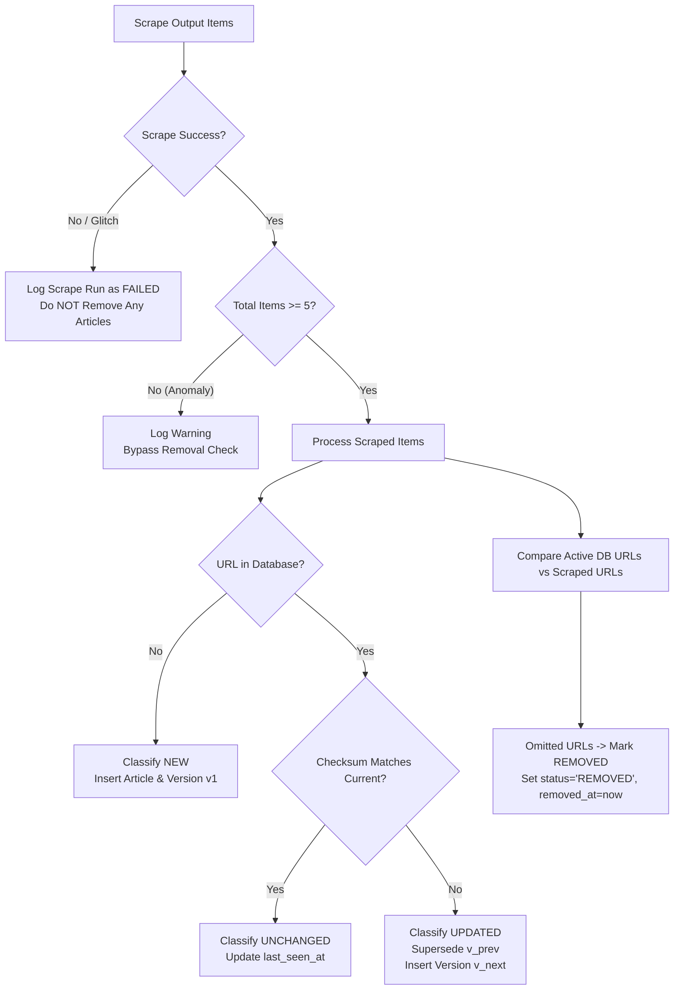

# Phase 4 — Change Detection & Historical Article Tracking Specification & Report

## 1. Overview & Purpose
Phase 4 introduces the persistent storage and historical change-tracking layer for the **Media Reporting System**. It evolves the application from a stateless scraper consumer to a stateful editorial intelligence platform.

The system determines whether an ingested article is:
- **`NEW`**: An article URL not previously present in the database.
- **`UPDATED`**: An existing article URL whose content checksum (headline, summary, image, section, published date) has changed.
- **`UNCHANGED`**: An existing article URL whose content checksum matches the previous version.
- **`REMOVED`**: A previously active article that disappeared from a valid, high-volume scrape run.

Every alteration is captured immutably in `article_versions`, enabling auditability and version timeline comparison while preserving past editorial states.

---

## 2. Database Schema Architecture

A thread-safe SQLite implementation (`WAL` mode enabled, foreign keys enforced) abstracted via an ANSI SQL Data Access Object (`database/repository.py`), providing clean compatibility with future PostgreSQL migrations.

```
                      +-------------------+
                      |     websites      |
                      +-------------------+
                                | 1
                                |
                                | *
                      +-------------------+
                      |     articles      |
                      +-------------------+
                                | 1
                                |
                                | *
                      +-------------------+
                      | article_versions  |
                      +-------------------+
                                ^
                                |
                      +-------------------+
                      |    scrape_runs    |
                      +-------------------+
```

### 2.1 Table Definitions
1. **`websites`**: Registered media publications (`et_brand_equity`, `exchange4media`).
   - `id INTEGER PRIMARY KEY`, `name`, `key UNIQUE`, `base_url`, `is_active`, `created_at`.
2. **`sections`**: Normalised publication sections per website.
   - `id INTEGER PRIMARY KEY`, `website_id`, `name`, `normalized_slug`, `UNIQUE(website_id, normalized_slug)`.
3. **`articles`**: Persistent canonical article identity.
   - `id INTEGER PRIMARY KEY`, `website_id`, `section_id`, `url`, `canonical_url`, `first_seen_at`, `last_seen_at`, `status` (`ACTIVE`, `ARCHIVED`, `REMOVED`), `removed_at`, `current_version_id`.
   - **Constraint**: `UNIQUE(website_id, url)` prevents cross-publisher collisions while ensuring strict per-publisher uniqueness.
4. **`article_versions`**: Append-only revision history.
   - `id INTEGER PRIMARY KEY`, `article_id`, `version_number`, `headline`, `summary`, `image_url`, `section_name`, `published_at`, `scraped_at`, `content_hash`, `change_type` (`NEW`, `UPDATED`, `UNCHANGED`), `change_summary`, `scrape_run_id`, `valid_from`, `valid_to`.
5. **`scrape_runs`**: Audit log of every scrape execution.
   - `id INTEGER PRIMARY KEY`, `website_id`, `started_at`, `finished_at`, `duration_ms`, `status` (`RUNNING`, `COMPLETED`, `FAILED`), `total_scraped`, `new_items`, `updated_items`, `unchanged_items`, `removed_items`, `error_message`.

---

## 3. Article Identity & Content Hashing Rules

### 3.1 Primary Identity Rule
- Primary identity is strictly **`(website_id, canonical_url)`**.
- Canonical URLs are normalized (lowercased scheme and hostname, trailing slashes harmonized, tracking parameters stripped).

### 3.2 Deterministic SHA-256 Hashing
Content hash is computed across normalized article attributes:
$$\text{hash} = \text{SHA256}(\text{headline} + \text{summary} + \text{image\_url} + \text{section} + \text{published\_at})$$

- **Excluded fields**:
  - `scraped_at`: Excluded so repetitive scrapes at different timestamps do **NOT** trigger `UPDATED`.
  - `last_seen_at`: Excluded for identical reasons.
- **Normalization**: Text is trimmed, normalized, and empty values fall back to an empty string.

---

## 4. Change Detection Logic & Safeguards



### 4.1 Safeguards Against False Removals
- **Scraper Failure**: If `scrape_success == False`, the removal pass is completely bypassed.
- **Low-Yield Anomaly Guard**: If a successful scrape yields `< 5 articles` (below `MIN_ARTICLES_FOR_SAFE_REMOVAL`), removal detection is suppressed to prevent wholesale deletion due to partial DOM changes or blocked requests.
- **Atomic Transactions**: All operations for a scrape run are committed inside a transaction; failures roll back completely without partial state corruption.

---

## 5. API Endpoints Reference

| Method | Endpoint | Description |
|---|---|---|
| `GET` | `/api/monitoring/changes` | Returns paginated modifications (`NEW`, `UPDATED`, `REMOVED`) across all sites or filtered by website/timeframe, plus summary KPIs. |
| `GET` | `/api/monitoring/{website}/changes` | Returns modifications specific to a website (`et_brand_equity` or `exchange4media`). |
| `GET` | `/api/monitoring/{website}/articles/{id}/history` | Returns complete version history timeline for an article (supports integer ID, frontend slug ID, or `?url=` lookup). |
| `GET` | `/api/monitoring/scrape-runs` | Returns scrape execution telemetry logs with timing, status, and item lifecycle metrics. |
| `GET` | `/api/monitoring/{website}/scrape-runs` | Returns scrape runs for a specific website. |

---

## 6. Frontend UI Enhancements

1. **Changes View (`#changes`)**:
   - Live KPI summary cards: `Total Changes`, `New Articles`, `Updated Articles`, `Removed Articles`.
   - Filter bar: Website selector (`All Publications`, `ET BrandEquity`, `Exchange4media`), Change type (`All`, `NEW`, `UPDATED`, `REMOVED`), Timeframe (`All Time`, `Today`, `Past 24 Hours`, `Past 7 Days`).
   - Audit table with detected time, publisher tag, lifecycle badge, headline, section, and quick "History" action button.
2. **Article Intelligence Drawer (`openArticleDrawer`)**:
   - Displays real-time version history timeline fetched dynamically from `/api/monitoring/{website}/articles/0/history?url=...`.
   - Renders each version `v1, v2...` with timestamp ranges, active/superseded status, headline snapshot, and SHA-256 hash.
3. **Scraper Engine Telemetry (`#scraper-status`)**:
   - Status cards for ET BrandEquity and Exchange4media workers.
   - Historical scrape runs audit table displaying Run ID, publication, status, duration, total items, and breakdown counters (`+new`, `~upd`, `-rem`, `=unch`).
   - Interactive "Run Scraper Sync" button.

---

## 7. Verification & Test Suite

### 7.1 Unit Tests (`tests/test_change_detection.py`)
- **TEST 1**: First run on empty database with article A -> `NEW = 1`, `v1` created.
- **TEST 2**: Repeat run with identical article A -> `UNCHANGED = 1`, `v1` preserved, `last_seen_at` refreshed.
- **TEST 3**: Third run with modified headline -> `UPDATED = 1`, `v1` superseded, `v2` created as active.
- **TEST 4**: Scrape with changed `scraped_at` timestamp only -> `UNCHANGED = 1`, content hash matches.
- **TEST 5**: Article omitted in valid 5+ item scrape -> `REMOVED = 1`, status set to `REMOVED`.
- **TEST 6**: Scraper failure or 0 articles -> `REMOVED = 0`, articles remain `ACTIVE`.
- **TEST 7**: Similar headlines across ET and E4M -> Stored as 2 distinct records.
- **TEST 8**: Same URL on different `website_id` -> Composite unique key stores 2 distinct records.

### 7.2 Integration Tests (`backend/test_integration.py`)
- Verified initial database seeding.
- Verified 2-cycle ingestion test:
  - Cycle 1 (Initial Ingest): 25 ET NEW, 25 E4M NEW.
  - Cycle 2 (Repeat Ingest): 25 ET UNCHANGED, 25 E4M UNCHANGED, 0 NEW.
- Verified telemetry audit logging and API endpoints.

---

## 8. CLI Commands for Testing & Execution

### Run Change Detection Unit Tests
```powershell
python -m unittest tests/test_change_detection.py -v
```

### Run Full System Integration Verification
```powershell
python backend/test_integration.py
```

### Seed / Reinitialize Database Baseline
```powershell
python database/seed_initial.py
```

### Launch Application Server
```powershell
python run_server.py
```
*(Browse to `http://127.0.0.1:8000` to inspect Dashboard, Changes Feed, Scraper Telemetry, and Article Drawer history.)*
