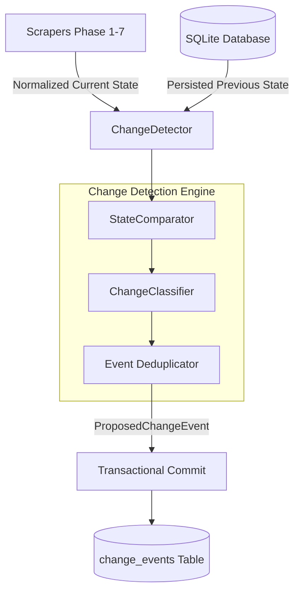

# FanCode Change Detection Engine (Phase 8)

## 1. Overview
The **Change Detection Engine** answers the central question of the FanCode monitoring system:
> **"What meaningfully changed since the previous scrape?"**

It strictly separates **state persistence** (updating volatile operational fields such as live cricket scores or football clock elapsed time) from **change event generation** (identifying noteworthy events such as matches going live, venue re-scheduling, or new video highlights published).

---

## 2. Architecture & Components



### Components
1. **[`StateComparator`](file:///d:/MFA/fancode/fancode_monitor/app/change_detection/comparator.py)**:
   - Canonicalizes strings (strips extra whitespace), datetimes (UTC ISO format), and URLs (strips tracking query params and fragments).
   - **Null-Safety Rule**: If a field is `None` in the incoming scrape, it signifies that the scraper did not observe or expose that field during the run; it is **never** treated as a deletion or field modification.
   - Computes deterministic SHA-256 fingerprints of entity snapshots.

2. **[`ChangeClassifier`](file:///d:/MFA/fancode/fancode_monitor/app/change_detection/classifier.py)**:
   - **Meaningful Fields**: Monitored for change events (`status`, `venue`, `start_time`, `title`, `duration_seconds`).
   - **Noisy Fields**: Volatile operational data (`score_summary`, `score`, `overs`, `wickets`, `elapsed_time`, `views`, `last_seen_at`) are explicitly ignored for change events.
   - **Semantic Change Types**:
     - `CREATED`: Brand new entity discovered.
     - `UPDATED`: Meaningful attribute updated (e.g. venue or start time reschedule).
     - `STATUS_CHANGED`: Status transitions (`UPCOMING` $\to$ `LIVE` $\to$ `COMPLETED`).
     - `REMOVED`: Entity removed from authoritative complete snapshot.
   - **Severity Assignment**:
     - `CRITICAL`: Match going `LIVE`, or match `CANCELLED`.
     - `IMPORTANT`: Match completed, venue rescheduled, match created, or entity removed.
     - `INFO`: Minor metadata adjustments.

3. **[`ChangeDetector`](file:///d:/MFA/fancode/fancode_monitor/app/change_detection/detector.py)**:
   - Coordinates detection across `Match`, `Sport`, `Tour`, and `Video` entities.
   - **Deduplication**: Queries the database using `(entity_type, entity_id, change_type, field_name, new_value)` to prevent re-firing duplicate events across consecutive scrape runs.
   - **Removal Safety**: Removal checks are **disabled by default**. They are only triggered if `complete_snapshot=True` is explicitly passed and the incoming list contains at least 1 item. A scrape failure or empty result will never trigger mass removal events.
   - **Dry Run Support**: Set `dry_run=True` to compute and preview proposed change events without writing to the database.

---

## 3. Database Schema

Changes are persisted in the `change_events` table:

| Column | Type | Description |
|---|---|---|
| `id` | `INTEGER` | Primary Key |
| `entity_type` | `VARCHAR(50)` | `"MATCH"`, `"SPORT"`, `"TOUR"`, `"VIDEO"` |
| `entity_id` | `INTEGER` | Foreign ID of the entity |
| `external_id` | `VARCHAR(100)` | FanCode source identifier |
| `change_type` | `VARCHAR(50)` | `"CREATED"`, `"UPDATED"`, `"STATUS_CHANGED"`, `"REMOVED"` |
| `field_name` | `VARCHAR(100)` | Name of the field that changed (nullable) |
| `old_value` | `TEXT` | Normalized old value |
| `new_value` | `TEXT` | Normalized new value |
| `source_url` | `VARCHAR(1000)` | Canonical source URL |
| `severity` | `VARCHAR(20)` | `"INFO"`, `"IMPORTANT"`, `"CRITICAL"` |
| `scrape_run_id` | `INTEGER` | Optional link to `scrape_runs` |
| `metadata_json` | `JSON` | Contextual diagnostic metadata |
| `detected_at` | `TIMESTAMP` | Timestamp of detection |
| `notified_at` | `TIMESTAMP` | Nullable timestamp reserved for Phase 9 notifications |

---

## 4. Standalone CLI Usage

Run change detection directly from the command line:

```powershell
python run_change_detection.py --dry-run
python run_change_detection.py --entity-type MATCH
python run_change_detection.py --complete-snapshot
```
